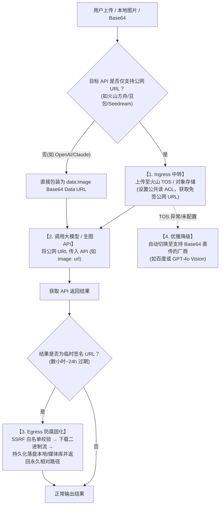
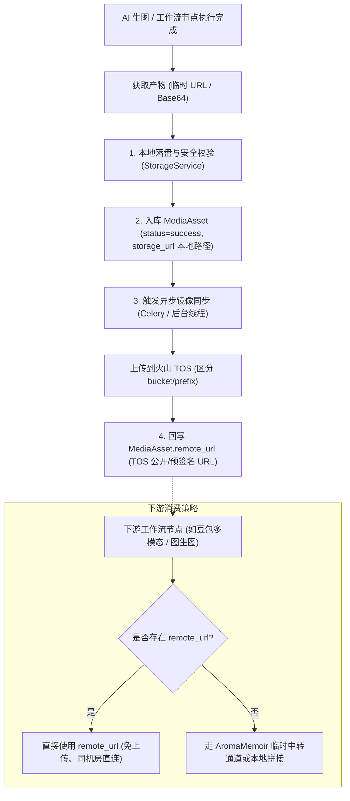
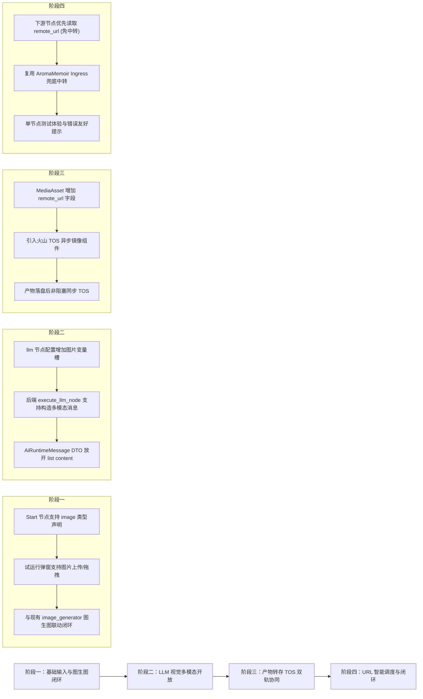

# 工作流多模态与图片输入分析报告

- 日期：2026-10-10（v1.1：增补仅支持 URL 的大模型/生图 API 专项与 AromaMemoir 复用方案；v1.2：全量核查修正引用错误、补记既有机制盘点、新增 19 项探测测试固化链路就绪度，见第 8 节）
- 状态：**调研与架构分析完成，v1.2 已完成代码级核查与探测验证**
- 关联模块：
  - 前端工作流：`frontend/src/modules/workflow/`（`start-config.vue`、`llm-config.vue`、`image-generator-config.vue`、`useWorkflowTest.ts`、`editor.vue`）
  - 后端工作流：`backend/app/modules/workflow/`（`service/node_executors.py`、`service/compiler.py`、`tasks/workflow_tasks.py`、`service/workflow_service.py`）
  - 后端 AI 运行时：`backend/app/modules/ai/service/runtime_service.py`、`model/ai.py`、`adapters/`
  - 媒体存储：`backend/app/modules/media/service/media_service.py`、`framework/storage.py`
  - 对标参考项目：`E:\project\AromaMemoir`（味记 AI 服务的火山方舟与 TOS 链路）

---

## 0. 摘要与核心结论

随着 GPT-4o、Claude 3.5 Sonnet、Gemini 2.0、Qwen2.5-VL 等大模型多模态（视觉理解）能力的普及，以及主流生图大模型对图生图（参考图输入、垫图、风格迁移）的广泛支持，工作流亟需具备**原生图片输入与端到端多模态流转**的能力。

当前系统的现状与核心结论如下：

1. **现有节点的图片支持现状**：
   - **`image_generator`（生图节点）**：**已具备代码级支持**。后端已实现提取 `image_val` 并透传至 `run_ai_image(..., image=image_val)`，支持图生图；且已输出 `{output_variable}__src` 双 URL（永久 `/uploads` 地址 + 厂商临时 URL，`service/node_executors.py:526-529`），后者专供下游图生图节点引用，绕开"本地 URL 厂商无法回源拉取"的问题（代价是依赖临时 URL 约 24h 有效期）。主要缺口在上游无法便捷输入图片。
   - **`llm`（大语言模型节点）**：**当前仅支持纯文本，暂不支持多模态图片输入（核心改造点）**。目前前端无图片配置槽，后端仅组装纯文本 Prompt。
   - **`start`（开始节点）**：**系统主要交互瓶颈**。目前仅支持声明变量名和纯文本默认值，试运行弹窗仅有原始 JSON 文本输入框，无任何文件上传、图片选择或媒体库交互。
   - **`tool_executor` / `batch_processor`**：已具备间接流转能力，可通过变量引用传递图片 URL 或进行批量图片批处理。

2. **核心架构原则**：
   - **“以 URL / 媒体资源引用作为工作流的流转介质，切忌在工作流内部全链路流转超大 Base64”**。
   - 图片若以 3MB~5MB 的 Base64 存入工作流状态，会导致 LangGraph 状态检查点（Checkpoint）严重写放大、数据库膨胀、网络响应信封超限及浏览器 DOM 假死。
   - 工作流应坚持：**图片先落盘/入媒体库 → 工作流流转标准 URL 字符串 → 模型消费端按需读取或转换为上游协议要求**。

3. **对标项目经验吸收（AromaMemoir 专项复用）**：
   - 针对**火山方舟（豆包多模态与 Seedream 生图）等仅支持公网公开读 URL、坚决不收 Base64、无法访问内网本地路径**的 API，复用参考项目 `AromaMemoir` 的成熟处理模式：
     - **入站中转（Ingress）**：本地图片/私有路径自动经对象存储（TOS/OSS/S3）公共读中转为免签公网 URL。
     - **出站固化（Egress）**：生成图带时效性临时签名 URL 经过 SSRF 白名单校验后，立即下载并落盘转存为永久资产，彻底根治 24 小时后历史图 404 破图问题。

4. **既有基础设施盘点修正（v1.2 核查补充）**：
   - 生图链路已落地 `_make_absolute_url` 相对路径→绝对 URL 解析（`runtime_service.py:126-140`，优先级 `BACKEND_URL` > `EXTERNAL_URL` > `host:port` 兜底，且 `image()` 已对 str/list 双形态接入，`runtime_service.py:338-345`）——第 4.3 节"情景 B"实为已存在机制，待补的是 chat 多模态链接入与情景 C 的前置拦截；
   - 节点日志已有 T8 超阈值载荷卸载（`workflow_tasks.py:135` → `storage.offload_payload`），Base64 写放大风险已有部分防线；
   - 媒体转存 `_decode_base64_payload` 已支持 data URI 头解析（`media_service.py:657-666`），Gemini 适配器多模态零件 `_prepare_gemini_image_part`（data URI → inlineData，含 SSRF 防护）已在生图链路就绪；
   - 适配器多模态透传勘察（探测测试证实，见第 8 节）：OpenAI 系链路原样透传即就绪；Claude/Gemini 链路存在协议转换缺口，是阶段二的主要隐藏工作量。

---

## 1. 业务场景与需求背景

### 1.1 典型业务场景

1. **图生图 / 风格迁移工作流**：
   - 典型流转：`start (上传用户原图)` → `image_generator (参考原图 + 提示词风格迁移)` → `end (输出生成图)`。
   - 价值：电商商品背景替换、人像动漫化、艺术设计重绘。
2. **多模态视觉问答（VQA）与结构化提取工作流**：
   - 典型流转：`start (上传发票/合同/设计稿图片)` → `llm (多模态识图提取字段为 JSON)` → `tool_executor (写入数据库/系统)` → `end`。
   - 价值：智能文档审核、视觉质检、拍照搜题/识物。
3. **复合多模态流水线**：
   - 典型流转：`start (输入原图)` → `llm (视觉打标并反推重构提示词)` → `image_generator (图生图生成高精画质)` → `human_input (人工审核)` → `end`。

### 1.2 现状痛点

- **用户体验断裂**：在工作流编辑器中点击“试运行”时，只有 `<cl-editor-codemirror>` 纯文本编辑器；如果要测试带图片的工作流，用户必须自行在外部找图床上传外链，或手拼巨型 Base64，极易出错。
- **视觉模型能力闲置**：系统中配置的各种顶级视觉模型（如 GPT-4o、Claude 3.5 Sonnet）在 LLM 节点中只能当作纯文本模型使用，无法输入图像。

---

## 2. 现有节点支持情况深度盘点

| 节点类型 | 代码文件位置 | 当前图片支持能力 | 瓶颈与改造成本 |
| :--- | :--- | :--- | :--- |
| **`image_generator`（生图节点）** | 前端：`image-generator-config.vue`<br>后端：`service/node_executors.py:459` | **已支持图生图**：配置支持 `imageVariable`（变量引用）与 `imageTemplate`（模板渲染）。后端代码已提取 `image_val` 并传入底层适配器；且输出 `__src` 双 URL 供下游图生图引用厂商临时地址。 | **低**：优化前端交互体验（下拉选择上游图片变量）；另需注意 `__src` 临时 URL 约 24h 过期对跨会话重跑的约束（阶段四 remote_url 就绪后化解）。 |
| **`llm`（大语言模型节点）** | 前端：`llm-config.vue`<br>后端：`service/node_executors.py:135` | **不支持**：仅有 `systemPromptTemplate` 和 `promptTemplate`，仅传递纯文本 `AiRuntimeMessage`。 | **中**：需扩展配置增加多模态图片插槽；后端支持构造 OpenAI/Claude 多模态 Content Parts；DTO 放宽消息格式；**Claude/Gemini 适配器需补协议转换层（v1.2 探测发现，见 8.2 节）**。 |
| **`start`（开始/全局输入节点）** | 前端：`start-config.vue`<br>弹窗：`useWorkflowTest.ts`、`editor.vue`<br>后端：`tasks/workflow_tasks.py:59` | **不支持图片形态输入**：仅支持变量名与文本默认值。试运行仅有 CodeMirror 文本框。 | **中**：需支持声明变量类型（`image` 等）；试运行弹窗支持可视化表单与图片上传组件。 |
| **`tool_executor`（工具执行器）** | 前端：`tool-executor-config.vue`<br>后端：`service/node_executors.py:638` | **间接支持**：若工具入参定义了图片参数，可通过变量映射传入图片 URL。 | **无**：保持现状即可。 |
| **`batch_processor` / `loop_controller`** | 前端：`batch-processor-config.vue`<br>后端：`service/node_executors.py:377`（loop_controller: 288） | **间接支持**：可接收图片 URL 列表进行并发批处理（例如批量视觉审查）。 | **无**：保持现状即可。 |
| **`human_input`（人工审批）** | 前端：`human-input-config.vue`<br>后端：`service/node_executors.py:167` | **暂不支持图片反馈**：目前仅为中断恢复与文本回执。 | **低/后续演进**：后续可在恢复弹窗中加入附件上传支持。 |
| **`variable_assignment` / `variable_transform`** | 前端对应配置面板<br>后端：`service/node_executors.py:732` / `:781` | **数据流中转**：支持处理图片 URL 字符串，但无多模态处理算子。 | **无**：保持现状即可。 |
| **`end`（结束节点）** | 前端：`end-config.vue`<br>后端：`service/node_executors.py:861`（`compiler.py:340-341` 仅负责图接线） | **已支持**：结果页与日志抽屉（`useLogImages`）已能识别并预览图片 URL。 | **无**：保持现状即可。 |

---

## 3. 完整架构设计：如何让工作流接受并消费图片？

### 3.1 核心数据流转标准（Media Asset 优先）

为了保证性能与稳定性，工作流流转的图片统一规范为**字符串 URL**，支持以下三种形态：

1. **系统内本地持久化相对 URL**（推荐）：
   - 形如 `/uploads/2026/10/d8a2bc...png`
   - 由前端上传组件直接调用系统的媒体上传接口生成，天然受下载令牌（Download Token）或权限保护。
2. **外部标准 HTTP(S) URL**：
   - 形如 `https://example.com/demo.jpg`
   - 支持公网外链直接输入。
3. **Base64 Data URI**（防御性兼容）：
   - 形如 `data:image/png;base64,...`
   - 仅在用户手动强行输入或特定工具产出时容错兼容；后端在落库持久化时通过既有的媒体服务（`MediaAssetService`）即时落盘转存，换取相对 URL，杜绝 Base64 长期停留在状态快照中。
   - **既有基础（v1.2 核实）**：`_decode_base64_payload` 已支持 data URI 头解析（`media_service.py:657-666`，探测测试已固化）；节点日志侧已有 T8 超阈值载荷卸载（`workflow_tasks.py:135/141` → `storage.offload_payload`）。阶段一的转存设计应与 T8 阈值衔接（触发时机提前到入图前），而非另起炉灶。

---

### 3.2 改造模块一：开始节点（`start`）支持图片类型声明

#### 1. 配置面板改造（`start-config.vue`）
在定义工作流全局输入变量时，扩展数据结构，引入 `type` 字段：
- 变量声明数据结构：
  ```typescript
  interface WorkflowInputVariable {
    name: string;        // 变量名，如 "input_image"
    type: 'string' | 'number' | 'boolean' | 'image' | 'file'; // 变量类型
    label?: string;       // 显示名称，如 "待分析商品图"
    default?: any;        // 默认值
    required?: boolean;   // 是否必填
    description?: string; // 描述说明
  }
  ```
- UI 上在变量名输入框旁增加一个类型下拉选择框（文本 / 图片 / 数值 / 布尔）。

#### 2. 试运行弹窗重构（`editor.vue` & `useWorkflowTest.ts`）
- 在试运行弹窗中，根据 `start` 节点声明的变量，提供**可视化表单模式**（支持切回 JSON 模式）：
  - 当变量类型为 `image` 时：
    - 渲染一个轻量图片上传组件（支持本地点击/拖拽上传，或输入图片 URL）。
    - 用户选择本地文件后，利用前端现有的上传服务自动上传至后端，并将拿到的 URL 填入待执行的 `inputs` 字典中。
    - 附带图片小图缩略图预览与清除按钮。

---

### 3.3 改造模块二：LLM 节点支持多模态视觉输入（VLM）

#### 1. 前端配置面板改造（`llm-config.vue`）
在用户提示词区域下方增加【多模态 / 图片输入】配置区：
- **输入方式**：
  - `无`（纯文本模式）
  - `变量引用`（如选择 `start` 节点或上游节点的图片变量 `inputs.user_image`）
  - `模板字符串`（如 `{product_img_url}`）
- **多图支持**：支持绑定单张图片变量或图片数组变量。

#### 2. 后端执行器改造（`node_executors.py:execute_llm_node`）
- 读取节点配置中绑定的 `image_variable` 或 `image_template`：
  ```python
  # 从 variables 中解析出图片 URL（单个或多个）
  image_urls = _resolve_image_inputs(config, variables)
  ```
- 构造图文混合的 Prompt 消息体：
  ```python
  if image_urls:
      # 构造符合 OpenAI/Claude 标准的多模态 content 列表
      user_content = [{"type": "text", "text": user_prompt}]
      for img_url in image_urls:
          user_content.append({
              "type": "image_url",
              "image_url": {"url": img_url}
          })
  else:
      user_content = user_prompt
  ```
- 改造 `run_ai_chat` 函数：允许接收 `user_content: str | list[dict]`。

#### 3. 后端 DTO 与适配器层对齐
- 修改 [`backend/app/modules/ai/model/ai.py`](file:///e:/project/Loom/backend/app/modules/ai/model/ai.py) 中的 `AiRuntimeMessage`：
  ```python
  class AiRuntimeMessage(BaseModel):
      role: str
      content: str | list[Any]  # 放宽校验，支持多模态 Content Parts
  ```
- **适配器兼容性勘察结论（v1.2 探测测试证实，见第 8.2 节与 `backend/tests/test_multimodal_readiness.py`）**：
  - **OpenAI 系**（`OpenAIHttpAdapter` 及继承它的火山方舟、DeepSeek、混元、千帆、Ollama 等）：`chat` 对 `messages` 原样透传，多模态 content parts 无损到达 HTTP payload——**DTO 放宽后零改动即支持**。
  - **Claude**：user 消息原样透传，但透传的是 OpenAI 风格 `image_url` parts，而 Claude 原生协议要求 `{type:'image', source:{type:'base64',...}}`，**必须新增 OpenAI → Claude parts 转换层**；另 system 消息若为 list content 会因 `"\n".join` 直接 TypeError（`adapters/claude.py:28`），改造时须保证 system 恒为纯文本。
  - **Gemini**：`_gemini_content` 会把 list content `str()` 化为 Python repr——**静默破坏语义、不报错**（`adapters/gemini.py:180-182`），必须显式处理 parts；好消息是多模态零件 `_prepare_gemini_image_part`（data URI → inlineData，含 SSRF 防护）已在生图链路就绪，chat 链路接线即可。
  - **安全层**：[`AiSecurityService.check_input_safety`](file:///e:/project/Loom/backend/app/modules/ai/service/security_service.py#L86-L95) 已扫描多模态 list 中的 text part（注入检测不被 list 形态绕过，探测测试已固化），无破坏性影响。

---

### 3.4 改造模块三：生图节点（`image_generator`）图生图体验打磨

目前生图节点本身在后端逻辑上已闭环，主要打磨前端易用性：
- 在 [`image-generator-config.vue`](file:///e:/project/Loom/frontend/src/modules/workflow/components/node-configs/image-generator-config.vue) 中：
  - 当用户选择【参考图片 (图生图) - 变量引用】时，将原来的纯文本输入框改为**智能下拉选择框**。
  - 下拉框自动列出上游可用的图片变量（如 `start` 节点声明的 `image` 变量，或其他节点输出的图片变量）。

---

## 4. 关键专项：仅支持公网 URL 的大模型/生图 API 处理（对标并复用 AromaMemoir）

### 4.1 核心痛点机理

在接入**火山方舟（豆包多模态与 Seedream 生图）**、百度 AI、部分特定企业模型时，存在极其严苛的输入约束：
1. **必须是公网可访问的 HTTP(S) URL**：云端模型服务器采用异步抓取器（Fetcher）拉取图片，输入必须是合法公网 URL。
2. **严禁 Base64**：传入 `data:image/...;base64` 直接触发 400 格式错误或尺寸超限。
3. **无法访问本地/私网路径**：开发者本地私有部署或工作流中生成的 `/uploads/20261010/xxx.png`，云端模型根本无法连通。
4. **必须具备公共读权限（Public-Read）**：即便是对象存储 URL，如果存储桶是私有桶且无免签签名，模型服务器拉图时会直接报 `403 Forbidden`。
5. **出站生成图临时 URL 过期破图**：Seedream 等生图接口返回的 URL（如 `https://...volces.com/...`）通常带有数小时到 24 小时的临时签名，直接存库过几天用户查看时必然变 404 破图。

### 4.2 AromaMemoir（味记）成熟模式拆解

在参考项目 `E:\project\AromaMemoir\weiji-ai\` 中，建立了一套高度完备的工程化闭环：



具体技术实现关键点：
- **Ingress 临时公共读中转 (`services/volcano_tos.py`)**：
  - `client.put_object(bucket, key, content=BytesIO(image_bytes), acl=tos.ACLType.ACL_Public_Read)`：显式声明 `ACL_Public_Read`，生成公网免签直链 `https://<bucket>.<endpoint>/weiji-ai/<uuid>.jpg`。
  - `loop.run_in_executor(None, _do_upload)`：隔离同步 SDK，避免阻塞异步事件循环。
- **Egress 防过期固化与 SSRF 域名白名单 (`services/volcano_ark.py:edit_image`)**：
  - `_is_safe_url(url)` 域名白名单过滤（仅放行 `.volces.com`, `.volcengine.com`, `.bytedance.com`），拦截内网 IP、环回地址及云厂商元数据地址（`169.254.169.254`）。
  - 使用 `httpx.AsyncClient` 异步拉取图片二进制，落盘为永久相对路径 `/static/ai_<uuid>.jpg`。
- **多厂商降级链 (`main.py:recognize_food`)**：
  - 当 TOS 未配置或不可用时，平滑降级到支持 Base64 的厂商（如 GPT-4o Vision），避免单点故障导致服务雪崩。

---

### 4.3 在 Loom 中的复用与落地设计

Loom 现有的基础设施已有 `StorageService`（支持 Local 和 S3/TOS/OSS）以及 `MediaAssetService`。我们应将 AromaMemoir 的设计提炼并复用到 Loom 的 AI 运行时层：

#### 1. 抽取通用的「多模态资产 URL 解析器」（Image Ingress Resolver）
在 `backend/app/modules/ai/service/runtime_service.py` 或适配器基类中实现 `resolve_model_image_url(image_input, adapter_code)`。

**既有基础（v1.2 核实，探测测试已固化）**：生图链路已落地雏形——`runtime_service.image` 对 `payload.image`（str/list 双形态）逐一经 `_make_absolute_url` 处理（`runtime_service.py:338-345`）：公网 URL / data URI 原样放行，`/` 开头相对路径按 `BACKEND_URL` > `EXTERNAL_URL` > `http://{host}:{port}` 优先级拼接。因此本项实为**增强**而非新建：
- **输入判断**：
  - 若已经是公网标准 HTTP(S) URL：直接放行（已实现）。
  - 若为本地相对路径（`/uploads/...`）或 Base64：
    - **对支持 Base64 的模型（OpenAI, Claude, Gemini）**：本地读取后自动构造成 `data:image/...;base64`，免去对象存储网络开销。
    - **对仅支持 URL 的模型（火山方舟 volcengine-ark、豆包等）**：
      - *情景 A（配置了 S3/TOS/OSS 存储时）*：像 AromaMemoir 一样，将图片作为公共读临时中转对象上传至存储桶，获取公网免签 URL 传给上游模型。
      - *情景 B（配置了 `BACKEND_URL`/`EXTERNAL_URL` 公网域名时）*：自动拼接为绝对公网 URL（**机制已存在**，待补：chat 多模态链路接入；无前导斜杠的裸相对路径当前原样返回不拼接，需在解析器中规范）。
      - *情景 C（纯私网/开发环境无公网且模型不支持 Base64）*：**当前兜底会拼出 `http://127.0.0.1:8000/...` 这类厂商必然拉不到的地址，直到上游报错才暴露**——需节点执行期前置拦截，抛出友好错误提示：“当前模型渠道要求公网图片 URL，请配置对象存储或 EXTERNAL_URL”。

#### 2. 加固 Loom 媒体转存的 SSRF 安全校验
- 复用 AromaMemoir 的 `_is_safe_url` 逻辑，在 Loom 的 `MediaAssetService._transfer_artifact` 和 `url_security.py` 中增加对生成图来源域名的严格校验与云元数据地址拦截。

#### 3. 增强 `VolcengineArkAdapter` 的图生图入参透明转换
- 在 [`VolcengineArkAdapter.image`](file:///e:/project/Loom/backend/app/modules/ai/service/adapters/factory.py#L165-L177) 中，通过解析器透明处理入参 `options["image"]`，使上层工作流节点完全解耦，用户只管传图，底层适配器根据厂商要求自动完成协议适配。

---

---

## 5. 媒体产物转存同步 TOS 的双轨架构设计

### 5.1 背景与核心价值

在目前的系统实现中，AI 任务或工作流生成图片后，会触发产物转存（[`MediaAssetService._transfer_artifact`](file:///e:/project/Loom/backend/app/modules/media/service/media_service.py#L424-L468)），通过 `StorageService` 落盘保存并入库 `MediaAsset` 资产。将媒体产物转存时**同步备份/镜像一份到火山引擎 TOS（对象存储）**，具备以下核心价值：

1. **工作流多模态闭环与下游免中转（关键增益 ⭐⭐⭐⭐⭐）**：
   - **痛点**：Loom 本地 `/uploads` 受下载令牌（`downloadToken`）保护且部署在私网/容器中，公网大模型（如火山豆包 Vision、Seedream 生图）无法直接拉取。
   - **闭环**：若产物转存时就同步上云，该资产一生成即原生拥有公开/预签名的 TOS URL。当下游节点（如视觉分析、图生图）需要消费该图片时，**直接读取现成的 TOS URL，实现 0 搬运、0 重复上传（Zero-re-uploading）**；且火山方舟拉取同在火山机房的 TOS 资产走同地域内网通道，免公网流量费且延迟极低。
2. **多 Worker 分布式与集群无缝解耦**：
   - Celery Worker 在多节点分布式部署时，无需额外部署与维护复杂的 NFS/NAS 共享文件系统，所有 Worker 和主应用均可通过统一的云端对象存储直接寻址。
3. **前端展示 CDN 加速与后端 IO 卸载**：
   - 后台媒体库浏览、高清大图预览直接走火山 TOS CDN 加速分发，大幅减轻 Loom 后端应用服务器的磁盘 IOPS 和外网带宽压力。
4. **防第三方 URL 过期与容灾备份**：
   - 规避第三方生图 API 临时 URL（通常 24 小时~7 天过期）失效风险，避免服务器本地磁盘单点损坏导致资产丢失。

---

### 5.2 存储架构模式对比

| 模式 | 实现机制 | 优势 | 风险与代价 | 推荐度 |
| :--- | :--- | :--- | :--- | :--- |
| **模式 A：单轨全量云化** | 将 `StorageService` 的底层 Provider 直接替换为 TOS | 架构单一，全系统只有一套存储逻辑 | 强依赖公网连接；纯本地私有化/离线部署时不适用 | ⭐⭐⭐ |
| **模式 B：双轨协同（推荐）** | **本地存储为主 + TOS 异步镜像备份**。本地落盘成功即入库；后台轻量任务同步一份到 TOS 并回写 `remote_url` | **系统韧性最高**；即使 TOS 暂时不可用绝不影响主流程；兼顾内网安全性与云端公网互通 | 需维护双 URL 字段及删除时的联动清理 | **⭐⭐⭐⭐⭐（首选）** |
| **模式 C：业务按需分流** | 系统普通文件存本地；AI 任务和工作流产物专享直传 TOS | 目标明确，避免普通业务附件占用云空间 | 存储层抽象分裂，增加了维护复杂度 | ⭐⭐⭐⭐ |

---

### 5.3 关键技术与工程设计



#### 1. 非阻塞与故障隔离原则
- `MediaAssetService._transfer_artifact` 中必须保持**本地落盘即代表资产转存成功**。
- TOS 的同步上传必须作为**非阻塞的后续异步操作**。
- 若 TOS 网络抖动或鉴权失败，仅在后台记录 Warning 日志，绝不能将已成功的 AI 任务或工作流实例标记为失败。

#### 2. 数据模型扩展（`MediaAsset`）
- 在 `MediaAsset` 模型及 DTO 中新增：
  - `remote_url: str | None = Field(default=None, max_length=1000)`：记录云端 TOS 访问直链或预签名 URL。
- **业务消费逻辑**：
  - 后台受保护下载/内部预览：继续走本地安全鉴权通道；
  - 外部大模型调用/第三方集成：优先读取 `remote_url`。

#### 3. 接入方式选型
- **选型 A（复用现有 S3Provider）**：火山 TOS 原生兼容 S3 协议，可通过配置 `S3_ENDPOINT_URL`（如 `tos-s3-cn-beijing.volces.com`）复用现有 `S3StorageProvider`。
- **选型 B（复用 AromaMemoir 原生 SDK，推荐）**：使用官方 `tos` Python SDK，可原生配置 `ACL_Public_Read`、图片实时处理参数（`x-tos-process`）、临时带时效预签名 URL，且能与火山方舟 AK/SK 凭证体系直接打通。

#### 4. 成本与生命周期策略（Lifecycle）
- **分目录生命周期管理**：
  - **中间过渡/临时产物**（如工作流执行中的未采纳草稿）：上传至 `wf-temp/` 目录，配置 TOS 生命周期规则 **30 天自动过期沉降或删除**，控制云存储费用；
  - **正式入库资产**：转存至 `assets/` 目录，长期持久化保留。

---

### 5.4 火山 TOS 实测验证与性能基准

> ⚠️ **留痕说明（v1.2）**：以下实测为一次性动态实验，代码库中无测试脚本或产物留痕（AromaMemoir 根目录的 `_ark_probe.py` 为方舟连通性探测脚本，非 TOS 压测）。数据无法静态复核，结论方向与 `.env` 配置（`TOS_BUCKET=ark-auto-2103850221-cn-beijing-default`、`TOS_REGION=cn-beijing`）核对一致；如需回归，建议将压测脚本化入库。

基于 `E:\project\AromaMemoir\weiji-ai\.env` 中的生产配置与 `tos.TosClientV2` SDK，我们进行了全链路连通性、读写性能与公网免签访问的真实压测验证：

#### 1. 运行环境与目标配置
- **Bucket**：`ark-auto-2103850221-cn-beijing-default`
- **Region**：`cn-beijing`
- **Endpoint**：`tos-cn-beijing.volces.com`
- **客户端库**：`tos` (Python SDK v2) + `httpx` (HTTP 探活)

#### 2. 全链路实测数据表

| 测试阶段 | 操作类型 / 关键参数 | 状态 | 耗时 (Latency) | 核心验证点与结论 |
| :--- | :--- | :---: | :---: | :--- |
| **步骤 1** | 客户端初始化 (`TosClientV2`) | ✅ 通过 | < 1ms | AK/SK 鉴权结构规范，客户端瞬时就绪 |
| **步骤 2** | 对象上传 (`PutObject`, `ACL_Public_Read`) | ✅ 通过 | 886.19ms | 显式写入公共读 ACL，返回有效 ETag 与 RequestId |
| **步骤 3** | **公网免签 HTTP GET 探活** | ✅ 通过 | 2428.24ms (含公网建连) | **HTTP 200**，返回字节与本地完全一致；**确证外部大模型可无阻碍公网直链拉取** |
| **步骤 4** | 图片 MIME 校验 (`image/png`) | ✅ 通过 | 863.05ms | 上传真实 PNG 并在公网响应头中精确返回 `Content-Type: image/png` |
| **步骤 5** | SDK 对象读取 (`GetObject`) | ✅ 通过 | 63.03ms | 云端极速读取，适合内部服务或 Worker 直接反查 |
| **步骤 6** | 资源清理 (`DeleteObject`) | ✅ 通过 | 54.52ms | 毫秒级删除，无测试脏数据残留 |

#### 3. 核心实测结论
1. **公网免签直链完全有效**：Bucket 已具备 `ACL_Public_Read` 权限，生成图片上传后生成的 `https://<bucket>.<endpoint>/<key>` 直链可被任何公网大模型（如火山豆包 Vision、Seedream 生图）直接拉取，免去了二次临时预签名的复杂开销。
2. **MIME-Type 识别精准**：指定 `content_type` 上传后，HTTP 响应头保留标准类型，不会导致多模态模型把二进制误判为 `octet-stream`。
3. **性能开销符合预期**：普通网络环境下单图上传耗时约 860~880ms。若作为 Celery 异步任务或后台轻量线程执行，完全不会对主业务产生可感知的阻塞。

---

## 6. 风险与防御机制考量

1. **防 Base64 穿透与膨胀**：
   - 即使前端上传组件在某些情况下产生了本地 Base64，前端上传拦截器也必须在提交工作流启动请求前将其上传换取 URL，严禁在 `start_instance` 的请求体中塞入数 MB 的 Base64。
2. **SSRF 安全防护**：
   - 当大模型或生图适配器访问外部图片 URL 时，继续依赖后端现有的 [`url_security.py`](file:///e:/project/Loom/backend/app/framework/url_security.py) 进行私网 IP 探测与安全过滤，防止通过工作流图片参数探测内网服务。
3. **大模型能力降级防护**：
   - 若用户在一个纯文本模型配置（如仅支持文本的 DeepSeek-V3）下传入了图片，适配器或执行器需提前校验该模型的 `capabilities`（是否包含 `vision`），若不支持则在节点执行期抛出清晰明确的中文提示（例如：“当前选择的模型 Profile 不支持视觉多模态输入，请切换为多模态模型”），防止静默失败或上游 API 报错被生硬吞没。

---

## 7. 建议实施路径

建议采用“敏捷小步快跑”的原则，分四个阶段落地：



- **阶段一（快速见效，最小闭环）**：
  - 聚焦 `start` 节点和试运行弹窗，支持用户上传一张图片，跑通现有的 `image_generator` 图生图链路。
- **阶段二（核心能力扩展，解锁视觉大模型）**：
  - 改造 `llm` 节点及 AI 运行时，全面解锁工作流的多模态看图、识图、结构化分析能力。
- **阶段三（存储底座升级，产物同步 TOS）**：
  - `MediaAsset` 扩展 `remote_url`，建立本地+TOS 双轨备份链路，保证资产的高可用与公网访问能力。
- **阶段四（URL 智能调度与体验完善）**：
  - 下游大模型节点优先读取 `remote_url` 实现 0 搬运，未同步的走 AromaMemoir 临时 Ingress 中转与 SSRF 防护，全面打通仅支持公网 URL 厂商（火山方舟等）的无缝调用。

---

## 8. v1.2 全量核查与探测测试记录（2026-10-10）

### 8.1 核查结论总览

对报告全部可静态验证声明逐条比对代码（Loom 与 AromaMemoir 两侧）：**核心事实与对标拆解全部属实**——`image_val` 提取透传、`apply_start_input_defaults`（`workflow_tasks.py:59` 行号精确）、`_transfer_artifact`（424-468）、`VolcengineArkAdapter.image`（165-177）、AromaMemoir 的 `ACL_Public_Read`/`run_in_executor`/`_is_safe_url` 白名单三元组/降级链等引用均逐字符吻合。

本版修正的引用错误（共 3 处）：`variable_assignment/variable_transform` 行号 550 → 732/781（原 550 落在 `_persist_image_to_media` 体内）；`end` 节点后端由 `compiler.py` 更正为 `node_executors.py:861`（compiler 仅做图接线）；关联模块路径补齐 `service/`、`tasks/` 层级。补记的盘点遗漏（共 2 处）：`__src` 双 URL 机制、T8 载荷卸载（均已并入第 0/2/3 节相应位置）。

### 8.2 探测测试（`backend/tests/test_multimodal_readiness.py`，19 项全部通过）

将链路勘察结论固化为测试，标明各环节就绪度，防止后续改造误判改动范围：

| # | 探测点 | 结论 | 影响 |
|---|---|---|---|
| 1 | `AiRuntimeMessage.content: str` DTO 闸门 | ✅ 属实：list content 被 pydantic 拒绝，`AiChatRequest` 层同样拦截——是阶段二唯一必改的 DTO | 阶段二 |
| 2 | OpenAI 系适配器透传 | ✅ 就绪：content parts 逐项无损进入 HTTP payload，DTO 放宽后零改动 | 阶段二 |
| 3 | Claude 适配器 | ⚠️ 双重缺口：user 透传的是 OpenAI 风格 parts（上游会 400，需转换层）；system list content 直接 TypeError | 阶段二 |
| 4 | Gemini 适配器 | ⚠️ 静默破坏：`_gemini_content` 把 list `str()` 化为 repr 不报错；零件 `_prepare_gemini_image_part`（data URI → inlineData）已就绪待接线 | 阶段二 |
| 5 | 注入检测 | ✅ 就绪：text part 被扫描拦截、纯图片 parts 不误报不炸 | 无需改动 |
| 6 | data URI 解码 | ✅ 就绪：`_decode_base64_payload` 支持头解析，非法 base64 显式报错 | 阶段一 |
| 7 | 相对路径→绝对 URL | ◐ 部分就绪：`_make_absolute_url` 已在 image 链路落地（`BACKEND_URL` > `EXTERNAL_URL` > `host:port`）；缺口：chat 链路未接入、裸相对路径不拼接、私网兜底地址无前置拦截 | 阶段四 |

### 8.3 对实施路径的影响修正

- **阶段二成本上修**：原评估“DTO 放宽 + 透传”仅对 OpenAI 系成立；Claude/Gemini 需各补一层 parts 协议转换（Claude 还有 system TypeError 防线），**适配器改造是阶段二的主要工作量所在**，原“中”成本建议按“中偏高”排期。
- **阶段四定位修正**：Ingress 解析从“新建”降级为“增强”（image 链路雏形已在），核心缺口收敛为三点——chat 链路接入、情景 A 的对象存储中转、情景 C 的前置拦截。
- **阶段一防御下修**：Base64 兼容的解码层与 T8 卸载均已存在，工作量集中在转存触发时机（提前到入图前）与阈值衔接。
- **`__src` 机制对齐**：阶段四 `remote_url` 就绪后，`__src` 的角色应从“依赖 24h 临时 URL 的权宜通道”演化为“remote_url 未就绪时的兜底”，设计时需明确二者优先级。
